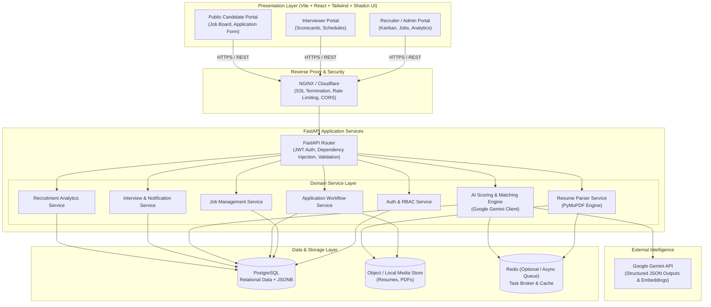
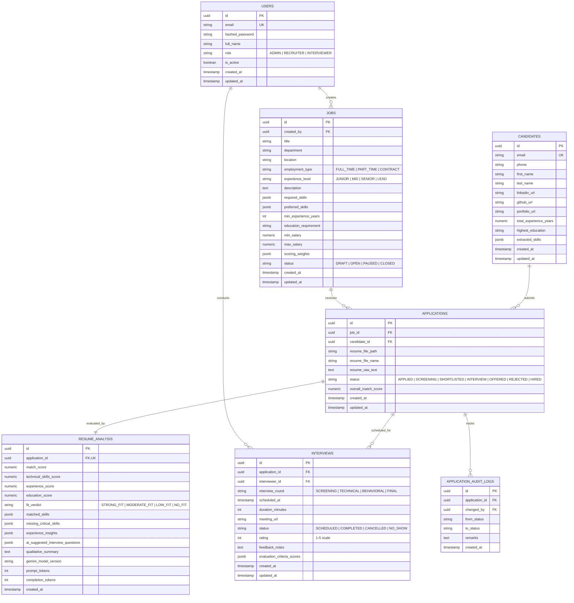
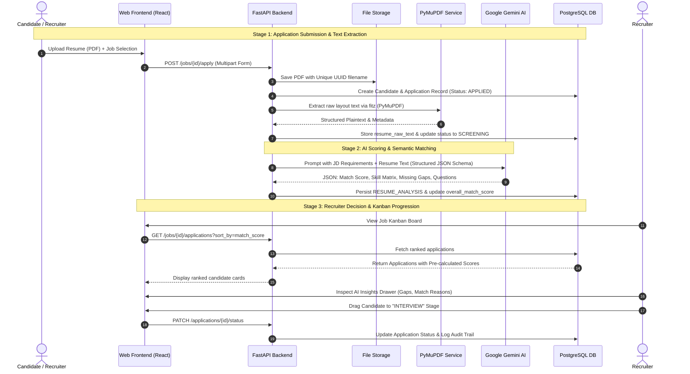
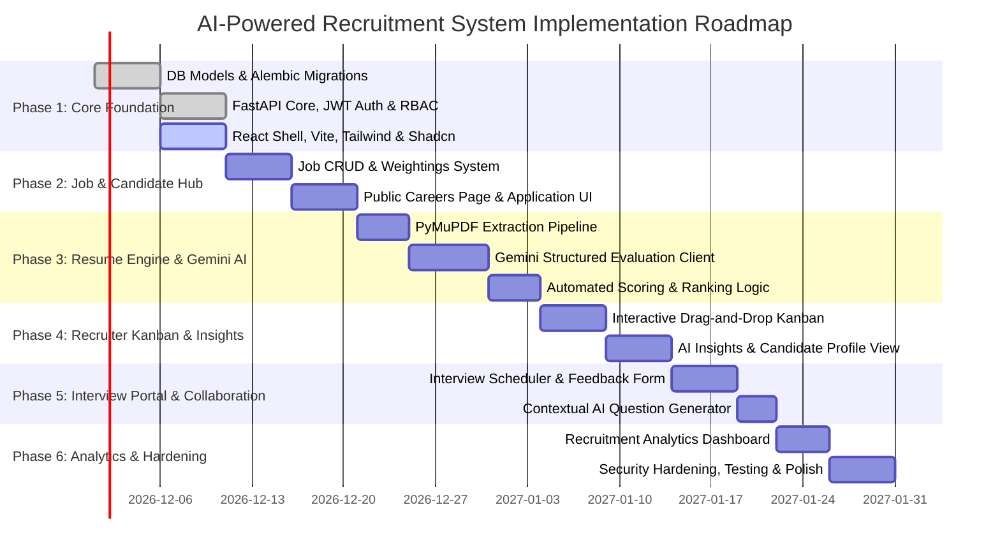

# AI-Powered Recruitment Management System (RMS)
## Enterprise Architecture & Technical Specification Document

**Version:** 1.0.0  
**Author:** Senior Full-Stack Software Architect & Product Engineer  
**Status:** Approved for Implementation  
**Stack:** React (Vite) + Tailwind CSS + Shadcn UI | FastAPI + SQLAlchemy + PostgreSQL | Google Gemini API + PyMuPDF  

---

## 1. Executive Summary & Project Requirements

### 1.1 Overview
The **AI-Powered Recruitment Management System (RMS)** is an enterprise-grade Applicant Tracking and Talent Intelligence Platform designed to streamline modern end-to-end recruitment pipelines. The platform solves critical recruitment bottlenecks: manual resume screening, keyword-stuffing deception, unstructured candidate data, delayed candidate turnaround, and recruiter bias.

By integrating **PyMuPDF** for deterministic PDF layout text extraction and **Google Gemini (Gemini 1.5 Flash / 2.0 Flash)** for semantic reasoning, contextual qualification extraction, and multi-dimensional scoring, this platform empowers hiring teams to rank, screen, and interview applicants with precision and explainability.

### 1.2 Core Architectural Principles
- **Decoupled Client-Server Architecture:** High-speed client-rendered Single Page Application (SPA) consuming stateless RESTful FastAPI services.
- **Explainable AI (XAI):** AI does not simply output a black-box score; it provides rubric-based breakdowns (Technical Skills, Relevant Experience, Domain Fit, Education) with highlighted evidence and gap analysis.
- **Fail-Safe & Non-Blocking Ingestion:** Resume extraction and LLM inferencing operate asynchronously so candidate uploads never block HTTP request workers.
- **Multi-Tenant & Role-Based Access Control (RBAC):** Strict isolation between candidate-facing forms and internal recruiter workflows.
- **Data Privacy & Compliance Ready:** PII redaction capabilities, encrypted storage for resumes, and audit trails.

---

## 2. High-Level System Architecture



---

## 3. User Roles & RBAC Matrix

The system enforces strict Role-Based Access Control (RBAC) via JWT claims and FastAPI security dependencies.

### 3.1 Role Descriptions
1. **Super Admin:** Full platform governance, tenant configuration, recruiter management, and system-wide audit access.
2. **HR Recruiter / Manager:** Job posting creation/closure, resume uploads, candidate pipeline progression, AI score inspection, and interview coordination.
3. **Interviewer / Hiring Manager:** Scoped access to assigned job requisitions and candidate scorecards; submits interview feedback and technical ratings.
4. **Candidate (Public / Applicant):** Read-only job board discovery, self-service job application submission, and basic application status lookup.

### 3.2 Granular Permissions Matrix

| Resource / Action | Super Admin | HR Recruiter | Interviewer | Candidate |
| :--- | :---: | :---: | :---: | :---: |
| **Manage Users & Roles** | Full Access | No | No | No |
| **Create / Edit / Close Jobs** | Full Access | Full Access | Read-Only (Assigned) | Read-Only (Published) |
| **View All Applications** | Full Access | Full Access | Assigned Only | Own Only |
| **Upload Candidates / Resumes**| Full Access | Full Access | No | Submit via Public Form |
| **Trigger / Re-run AI Analysis** | Full Access | Full Access | Read Scores Only | No |
| **Move Pipeline Stages (Kanban)**| Full Access | Full Access | Recommend Only | No |
| **Schedule Interviews** | Full Access | Full Access | View Assigned | View Own Schedule |
| **Submit Interview Scorecards**| Full Access | Full Access | Yes (Assigned) | No |
| **Access Recruitment Analytics**| Full Access | Full Access | Department Only | No |

---

## 4. Functional and Non-Functional Requirements

### 4.1 Functional Requirements (FR)

#### FR-1: Authentication & Authorization
- Secure user signup/login using bcrypt/argon2 password hashing.
- Stateless authentication using JWT tokens (Access token: 15-30 min; Refresh token: 7 days).
- Role-based route guards in both React frontend and FastAPI backend dependencies.

#### FR-2: Job Requisition Management
- Rich job descriptions with auto-generation support from Gemini (role overview, responsibilities, technical stacks).
- Structured extraction criteria: Required Skills, Preferred Skills, Minimum Experience Years, Education Levels, Seniority, and Weightages for scoring.
- Job status lifecycle: `DRAFT` $\to$ `OPEN` $\to$ `PAUSED` $\to$ `CLOSED` $\to$ `ARCHIVED`.

#### FR-3: Resume Ingestion & Parsing (PyMuPDF)
- Support PDF uploads (and optional DOCX conversion) up to 10MB.
- File integrity checks, MIME-type validation, and virus/malware sanitized file naming.
- Multi-column and multi-page text extraction using `PyMuPDF` (`fitz`), preserving text blocks, reading order, and metadata.
- Preprocessing pipeline: Whitespace normalization, phone/email masking options, section segmenter (Experience, Skills, Education, Certifications).

#### FR-4: AI Resume Matching & Ranking Engine (Gemini API)
- Semantic matching between candidate resume extraction and Job Description (JD).
- Multi-dimensional scoring formula:
  $$\text{Match Score} = (w_s \times S_{\text{skills}}) + (w_e \times S_{\text{exp}}) + (w_d \times S_{\text{edu}}) + (w_t \times S_{\text{domain}})$$
- Gemini Structured Output (via `response_mime_type="application/json"` & Pydantic schema validation):
  - Extracted Profile (name, contacts, links, total years of experience).
  - Categorized Skills (Demonstrated vs. Mentioned).
  - Missing Critical Skills & Suggested Interview Questions.
  - Qualitative strengths, weaknesses, and a 1-paragraph executive summary.

#### FR-5: Candidate Pipeline & Kanban Management
- Interactive visual drag-and-drop Kanban board representing stages:
  `Applied` $\to$ `AI Screened` $\to$ `Shortlisted` $\to$ `Interview Round 1` $\to$ `Technical Round` $\to$ `Offer Sent` $\to$ `Hired` $\to$ `Rejected`.
- Bulk candidate actions: Bulk rejection with templated emails, bulk stage transition, export to CSV/XLSX.

#### FR-6: Collaborative Interviewing & Notes
- Interview scheduling with calendar links and automated email notifications.
- Structured interviewer scorecards with criteria-based 1–5 star ratings and qualitative feedback.
- Gemini-generated contextual interview questions tailored specifically to candidate resume gaps.

#### FR-7: Analytics & Reporting
- Metrics: Time-to-hire, applicant drop-off rate, source breakdown, job vacancy velocity.
- AI Match distribution histogram per job opening.

---

### 4.2 Non-Functional Requirements (NFR)

- **Performance:**
  - API response time $\le 200\text{ms}$ for standard CRUD operations (p95).
  - PDF extraction via PyMuPDF completed $\le 800\text{ms}$ for standard 2–3 page CVs.
  - Total AI analysis pipeline $\le 4–8\text{s}$ per resume; non-blocking background queue prevents UI timeout.
- **Scalability:**
  - Stateless FastAPI instances horizontally scalable behind NGINX or cloud load balancer.
  - PostgreSQL connection pooling via `asyncpg` / `NullPool` / PgBouncer.
- **Security:**
  - OWASP Top 10 compliance: Strict CORS, CSRF considerations, input sanitization, SQL injection prevention via SQLAlchemy parameterized queries.
  - JWT tokens stored in HTTP-only, secure, SameSite cookies or secure memory.
  - Resumes stored with randomly generated UUIDs; public URLs prevented via signed or authenticated streaming endpoints.
- **Maintainability & Modularity:**
  - Strict separation of concerns (Presentation, Business Logic, Data Access).
  - Pydantic models serving as Single Source of Truth for contracts between Frontend and Backend.

---

## 5. System Modularization

The application is decomposed into eight cohesive micro-modules within a modular monolithic architecture:

```
+-------------------------------------------------------------------------------+
|                               FASTAPI CORE                                   |
|  +-------------------+  +--------------------+  +--------------------------+  |
|  |    Auth Module    |  |    Jobs Module     |  |    Candidates Module     |  |
|  | - JWT Management  |  | - CRUD Job Postings|  | - Application Lifecycle  |  |
|  | - RBAC Guards     |  | - Scoring Weights  |  | - Public Submissions     |  |
|  +-------------------+  +--------------------+  +--------------------------+  |
|  +-------------------+  +--------------------+  +--------------------------+  |
|  |   Parser Engine   |  |     AI Engine      |  |     Interview Module     |  |
|  | - PyMuPDF Extractor| | - Gemini API Client|  | - Scheduling             |  |
|  | - Text Sanitizer  |  | - Semantic Matcher |  | - Scorecards & Notes     |  |
|  +-------------------+  +--------------------+  +--------------------------+  |
|  +-------------------+  +--------------------------------------------------+  |
|  | Analytics Module  |  |           Shared Kernel / Core Services          |  |
|  | - Pipeline Metrics|  | - DB Session, Config, Errors, Logging, Storage   |  |
|  +-------------------+  +--------------------------------------------------+  |
+-------------------------------------------------------------------------------+
```

---

## 6. Project Directory Structure

### 6.1 Backend Structure (Python FastAPI)

```
backend/
├── app/
│   ├── api/
│   │   ├── v1/
│   │   │   ├── endpoints/
│   │   │   │   ├── __init__.py
│   │   │   │   ├── auth.py
│   │   │   │   ├── users.py
│   │   │   │   ├── jobs.py
│   │   │   │   ├── applications.py
│   │   │   │   ├── candidates.py
│   │   │   │   ├── analysis.py
│   │   │   │   ├── interviews.py
│   │   │   │   └── analytics.py
│   │   │   └── router.py
│   │   └── deps.py                    # Database sessions, current_user, role_checker
│   ├── core/
│   │   ├── config.py                  # Pydantic BaseSettings, env variables
│   │   ├── security.py                # Password hashing, JWT encode/decode
│   │   ├── database.py                # Async SQLAlchemy engine & session factory
│   │   └── exceptions.py              # Custom HTTP & domain exception handlers
│   ├── models/                        # SQLAlchemy ORM Models
│   │   ├── __init__.py
│   │   ├── user.py
│   │   ├── job.py
│   │   ├── candidate.py
│   │   ├── application.py
│   │   ├── analysis.py
│   │   └── interview.py
│   ├── schemas/                       # Pydantic Schemas (Request / Response DTOs)
│   │   ├── __init__.py
│   │   ├── token.py
│   │   ├── user.py
│   │   ├── job.py
│   │   ├── candidate.py
│   │   ├── application.py
│   │   ├── analysis.py
│   │   └── interview.py
│   ├── services/                      # Pure Business Logic Layer
│   │   ├── auth_service.py
│   │   ├── job_service.py
│   │   ├── application_service.py
│   │   ├── parser_service.py          # PyMuPDF implementation
│   │   ├── ai_service.py              # Gemini 1.5/2.0 API prompt engineering & parser
│   │   ├── interview_service.py
│   │   └── file_storage_service.py    # Local disk / Cloud storage handler
│   └── utils/
│       ├── logger.py
│       └── helpers.py
├── alembic/                           # Database Migrations
│   ├── versions/
│   └── env.py
├── tests/
│   ├── conftest.py
│   ├── test_auth.py
│   ├── test_parser.py
│   └── test_ai_engine.py
├── uploads/                           # Local storage for resumes (gitignored)
│   └── resumes/
├── .env.example
├── alembic.ini
├── Dockerfile
├── requirements.txt
└── main.py                            # ASGI Entrypoint
```

### 6.2 Frontend Structure (React.js with Vite + Tailwind + Shadcn UI)

```
frontend/
├── public/
│   └── favicon.ico
├── src/
│   ├── assets/
│   ├── components/                    # Atomic & Shared Reusable Components
│   │   ├── ui/                        # Shadcn UI primitives (button, dialog, card, badge, etc.)
│   │   │   ├── button.tsx
│   │   │   ├── dialog.tsx
│   │   │   ├── card.tsx
│   │   │   ├── badge.tsx
│   │   │   ├── table.tsx
│   │   │   ├── dropdown-menu.tsx
│   │   │   ├── input.tsx
│   │   │   ├── select.tsx
│   │   │   ├── progress.tsx
│   │   │   └── tabs.tsx
│   │   ├── layout/                    # Layout shells
│   │   │   ├── Navbar.tsx
│   │   │   ├── Sidebar.tsx
│   │   │   ├── DashboardLayout.tsx
│   │   │   └── AuthLayout.tsx
│   │   └── shared/                    # Application-wide compound components
│   │       ├── ScoreBadge.tsx
│   │       ├── FileUploader.tsx
│   │       ├── ConfirmDialog.tsx
│   │       ├── StatusBadge.tsx
│   │       └── EmptyState.tsx
│   ├── features/                      # Feature-Sliced Domain Modules
│   │   ├── auth/
│   │   │   ├── components/            # LoginForm, SignupForm
│   │   │   ├── hooks/                 # useAuth
│   │   │   └── types/
│   │   ├── jobs/
│   │   │   ├── components/            # JobCard, JobList, JobFormModal, JobFilter
│   │   │   ├── hooks/                 # useJobs, useJobDetails
│   │   │   └── types/
│   │   ├── candidates/
│   │   │   ├── components/            # CandidateCard, CandidateList, ResumeDrawer
│   │   │   ├── hooks/                 # useCandidates, useUploadResume
│   │   │   └── types/
│   │   ├── pipeline/
│   │   │   ├── components/            # KanbanBoard, KanbanColumn, KanbanCard
│   │   │   ├── hooks/                 # usePipeline
│   │   │   └── types/
│   │   ├── ai-insights/
│   │   │   ├── components/            # MatchScoreRadar, SkillsBreakdown, AIRecommendationCard
│   │   │   └── types/
│   │   └── interviews/
│   │       ├── components/            # ScheduleModal, ScorecardForm, QuestionList
│   │       └── types/
│   ├── context/                       # Global state (AuthContext, ThemeContext)
│   ├── hooks/                         # Generic hooks (useDebounce, useToast)
│   ├── lib/                           # Utilities & configured clients
│   │   ├── api-client.ts              # Axios instance with interceptors for JWT
│   │   └── utils.ts                   # Shadcn cn() helper
│   ├── pages/                         # Route Page Components
│   │   ├── LoginPage.tsx
│   │   ├── DashboardPage.tsx
│   │   ├── JobsPage.tsx
│   │   ├── JobDetailsPage.tsx
│   │   ├── PipelinePage.tsx
│   │   ├── CandidateProfilePage.tsx
│   │   ├── InterviewsPage.tsx
│   │   ├── AnalyticsPage.tsx
│   │   └── PublicApplyPage.tsx
│   ├── routes/
│   │   ├── AppRoutes.tsx
│   │   └── ProtectedRoute.tsx
│   ├── App.tsx
│   ├── index.css
│   └── main.tsx
├── components.json                    # Shadcn configuration
├── tailwind.config.js
├── postcss.config.js
├── tsconfig.json
├── vite.config.ts
└── package.json
```

---

## 7. Database Entities and Relational Architecture (PostgreSQL)

### 7.1 Entity Relationship Diagram (ERD)



### 7.2 Database Schema Definitions (SQL / DDL Details)

1. **`users`**
   - Primary identifier: UUID v4 (`id`).
   - `email`: Indexed, Unique, Non-null.
   - Enums: Role (`SUPER_ADMIN`, `RECRUITER`, `INTERVIEWER`).

2. **`jobs`**
   - Foreign Key: `created_by` $\to$ `users(id)`.
   - `required_skills`: `JSONB` for agile skill tagging, indexing, and GIN queries (`["Python", "FastAPI", "PostgreSQL"]`).
   - `scoring_weights`: `JSONB` (e.g., `{"skills": 0.40, "experience": 0.35, "education": 0.15, "domain": 0.10}`).

3. **`candidates`**
   - Normalized candidate table storing canonical profile data deduced across potential multiple job applications.
   - `email`: Indexed for deduplication check.

4. **`applications`**
   - Join entity between `candidates` and `jobs`.
   - `overall_match_score`: Cached numeric index `(0.00 to 100.00)` for immediate sorting in Recruiter Kanban and candidate tables.
   - Compound index: `(job_id, status)` and `(job_id, overall_match_score DESC)`.

5. **`resume_analysis`**
   - 1-to-1 relationship with `applications`.
   - JSONB columns store Gemini's structured analysis, preserving full explainability.

---

## 8. REST API Endpoints Specification

All endpoints follow RESTful conventions, prefixed with `/api/v1`. Protected routes require `Authorization: Bearer <JWT_ACCESS_TOKEN>`.

### 8.1 Authentication & User Management
| Method | Endpoint | Access | Description | Request Body / Params |
| :--- | :--- | :--- | :--- | :--- |
| `POST` | `/auth/login` | Public | Authenticate user & return JWT tokens | `{ email, password }` |
| `POST` | `/auth/refresh` | Public | Refresh expired access token | `{ refresh_token }` |
| `POST` | `/auth/logout` | Authenticated | Invalidate refresh session | None |
| `GET` | `/auth/me` | Authenticated | Retrieve current user profile & role | None |
| `POST` | `/users` | Super Admin | Provision recruiter or interviewer | `{ email, full_name, password, role }` |

### 8.2 Job Requisition Endpoints
| Method | Endpoint | Access | Description | Request Body / Params |
| :--- | :--- | :--- | :--- | :--- |
| `GET` | `/jobs` | Recruiter+ | List all jobs with pagination & filters | `?page=1&status=OPEN&search=python` |
| `GET` | `/jobs/public` | Public | List published jobs for candidate board| `?department=Engineering` |
| `GET` | `/jobs/{id}` | Public/Recruiter| Get job detail by ID | Path ID |
| `POST` | `/jobs` | Recruiter+ | Create a new job requisition | JobCreateSchema |
| `PUT` | `/jobs/{id}` | Recruiter+ | Update job details or scoring weights | JobUpdateSchema |
| `PATCH`| `/jobs/{id}/status`| Recruiter+ | Transition job status (`OPEN`, `CLOSED`)| `{ status: "CLOSED" }` |
| `DELETE`| `/jobs/{id}` | Super Admin | Soft delete or archive job | Path ID |

### 8.3 Candidate & Application Endpoints
| Method | Endpoint | Access | Description | Request Body / Params |
| :--- | :--- | :--- | :--- | :--- |
| `POST` | `/jobs/{id}/apply` | Public | Candidate applies with form + PDF file| Multipart form: `file`, `name`, `email` |
| `POST` | `/jobs/{id}/applications/upload` | Recruiter | Recruiter manually uploads candidate CV | Multipart form: `file` |
| `GET` | `/jobs/{id}/applications` | Recruiter+ | Get ranked applications for a job | `?sort_by=match_score&status=SCREENING` |
| `GET` | `/applications/{id}` | Recruiter+ | Get application metadata & raw text | Path ID |
| `PATCH`| `/applications/{id}/status` | Recruiter+ | Move candidate stage on Kanban | `{ status: "INTERVIEW", remarks: "" }` |
| `GET` | `/applications/{id}/resume` | Recruiter+ | Securely stream candidate PDF document | Path ID |

### 8.4 AI Resume Analysis Engine
| Method | Endpoint | Access | Description | Request Body / Params |
| :--- | :--- | :--- | :--- | :--- |
| `POST` | `/applications/{id}/analyze` | Recruiter+ | Trigger/Re-run PyMuPDF + Gemini scoring | `{ force_refresh: true }` |
| `GET` | `/applications/{id}/analysis` | Recruiter+ | Fetch AI insights, breakdown & questions | Path ID |
| `POST` | `/jobs/{id}/batch-analyze` | Recruiter+ | Trigger bulk AI scoring for unparsed CVs | None |

### 8.5 Interviews & Collaboration
| Method | Endpoint | Access | Description | Request Body / Params |
| :--- | :--- | :--- | :--- | :--- |
| `POST` | `/applications/{id}/interviews` | Recruiter | Schedule an interview round | InterviewCreateSchema |
| `GET` | `/interviews` | Interviewer+ | List scheduled interviews for user | `?from_date=2026-11-01` |
| `POST` | `/interviews/{id}/scorecard` | Interviewer | Submit ratings & qualitative feedback | `{ rating: 4, feedback: "...", scores: {} }` |

### 8.6 Analytics & Reports
| Method | Endpoint | Access | Description | Request Body / Params |
| :--- | :--- | :--- | :--- | :--- |
| `GET` | `/analytics/overview` | Recruiter+ | Pipeline KPI counts, time-to-hire | None |
| `GET` | `/analytics/jobs/{id}/scores` | Recruiter+ | Score distribution histogram for job | Path ID |

---

## 9. End-to-End Application Workflow



### Detailed Operational Lifecycle
1. **Requisition Setup:** Recruiter drafts a job posting, defining must-have tech skills, years of experience, and custom rubric weightings.
2. **Ingestion & Extraction:**
   - Candidate submits application via public portal or recruiter drags 50 resumes at once into the bulk recruiter uploader.
   - Files are saved to secure storage. `PyMuPDF` runs immediately: opening document streams, looping through pages, cleaning text headers/footers, and assembling normalized chronological plain text.
3. **AI Inference & Pydantic Validation:**
   - FastAPI formats an engineering prompt combining:
     - Target Job Context: Title, Must-have skills, Nice-to-have skills, Experience bounds.
     - Extracted Resume Raw Text.
   - Google Gemini is called with response schema enforcement (`response_mime_type="application/json"`).
   - Return payload includes: `match_score (0-100)`, `technical_skills_score`, `experience_score`, `education_score`, `fit_verdict`, `strengths`, `weaknesses`, `missing_skills`, and `suggested_interview_questions`.
4. **Ranking & Shortlisting:**
   - Recruiter accesses the Job Dashboard. Candidates are sorted dynamically by match score.
   - Recruiter can filter by specific missing or present skills, review the explainable summary, and click to view the original PDF in an inline viewer.
5. **Interview Loop & Decision:**
   - Candidate is dragged to the Interview column on the Kanban board.
   - An interview invite is issued. The interviewer uses Gemini's auto-generated gap-specific questions to interview the candidate.
   - Scorecards are captured in the system. The candidate is ultimately marked `OFFERED` or `REJECTED`.

---

## 10. Development Roadmap with Milestones

The project is structured into **6 iterative, milestone-driven phases**:



### Milestone Deliverables

#### Milestone 1: Core Infrastructure & Identity (Week 1–2)
- **Deliverables:**
  - PostgreSQL database configured with async SQLAlchemy and initial Alembic migrations.
  - JWT authentication flow with bcrypt password hashing and token refresh mechanism.
  - Role-based route authorization guards in FastAPI and React.
  - React + Vite baseline setup with Shadcn UI theming, global Axios client, and Auth Context.

#### Milestone 2: Job Requisition & Public Careers Portal (Week 3)
- **Deliverables:**
  - Job management API: CRUD operations with custom skill tags and weight configurations.
  - Recruiter Job Management UI with status filters (`OPEN`, `DRAFT`, `CLOSED`).
  - Responsive Public Careers page allowing candidates to search openings and view job requirements.

#### Milestone 3: Resume Parser (PyMuPDF) & Gemini AI Scoring Engine (Week 4–5)
- **Deliverables:**
  - Secure file upload service with MIME type verification and UUID storage.
  - PyMuPDF extraction engine extracting structured text segments from diverse CV layouts.
  - Google Gemini client integration using strict JSON output schema.
  - Normalized candidate scoring algorithm calculating overall match percentage and gap metrics.

#### Milestone 4: Recruiter Pipeline & Interactive Kanban (Week 6)
- **Deliverables:**
  - Drag-and-drop Kanban pipeline board with optimistic UI state transitions.
  - Candidate drawer with integrated PDF document viewer alongside AI match score breakdown.
  - Interactive skill tags highlighting matched vs. missing qualifications.

#### Milestone 5: Collaborative Interview Management (Week 7)
- **Deliverables:**
  - Interview scheduling modal with round tracking (Technical, HR, Managerial).
  - Interviewer scorecard module with rubric ratings and Gemini-suggested interview questions.
  - Status audit logs recording timestamped stage movements and reviewer comments.

#### Milestone 6: Analytics, Optimization & Deployment Readiness (Week 8)
- **Deliverables:**
  - Recruitment analytics dashboard (average score by department, hiring velocity, stage bottlenecks).
  - End-to-end integration tests (Pytest for backend API, Vitest/Playwright for UI).
  - Production-ready Docker containerization (`docker-compose.yml` for FastAPI, PostgreSQL, and React Nginx build).

---

## 11. Security, Resilience & Scalability Best Practices

1. **AI Cost & Rate Limit Management:**
   - Cache analysis results by resume content hash (SHA-256) to eliminate duplicate Gemini API calls if the same file is submitted twice.
   - Utilize Gemini 1.5 Flash / 2.0 Flash for standard screening (high speed, cost-effective, large context window) and reserve Gemini Pro for executive / senior-level deep evaluations.
2. **Data Isolation & PII Protection:**
   - Candidate contact information can be masked for blind screening during initial evaluation to minimize human bias.
   - Resume PDFs served only via authenticated streaming routes with appropriate permission checks.
3. **Database Optimization:**
   - GIN indexing on PostgreSQL `JSONB` columns (`required_skills`, `extracted_skills`) to enable ultra-fast filtering across thousands of applications.
   - Composite indexes on `(job_id, overall_match_score DESC)` to allow instantaneous retrieval of top-ranked applicants.

---
*End of Architecture Specification.*
